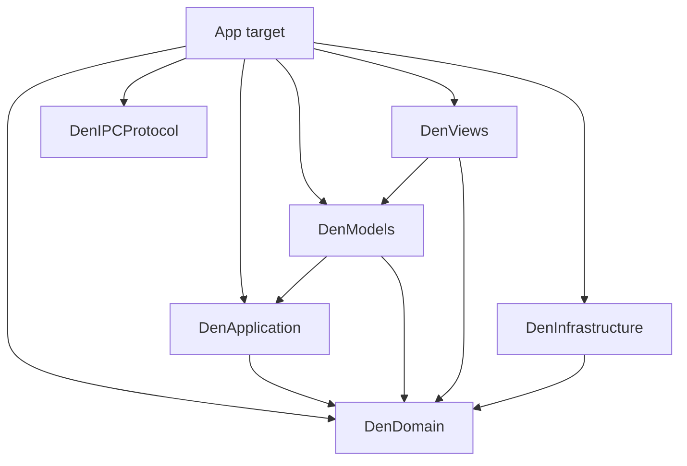

# Architecture

Shared responsibilities are separated into Swift packages. The app target assembles them and
contains scene and dependency composition, with native adapters and operations grouped by product Feature.

## Platform baseline

The app and test targets support macOS 26.0 and later. Availability and runtime capability rules are defined in [the agent guide](../AGENTS.md#platform-baseline).

## Packages and folders

Arrows point from the importing module to its dependency. Only local packages are shown.

| Package | Role |
| --- | --- |
| `DenDomain` | Domain values and product rules |
| `DenApplication` | Operation decisions, state transformations, and shared synchronous workflows |
| `DenModels` | Observable Profile state source and window/Feature Models |
| `DenViews` | Feature Views, native display adapters, and shared visual tokens and controls |
| `DenInfrastructure` | Profile persistence, filesystem and image-cache I/O, process sampling, and diagnostics |
| `DenIPCProtocol` | CLI/app request and response types |

App-target folders:

| Folder | Role |
| --- | --- |
| `App` | App entry, settings assembly, keyboard integration, and dependency composition |
| `Features` | Feature-owned operation adapters and native implementations |
| `IPC` | Socket transport and request handling |
| `Platform` | Feature-independent OS integration |
| `PrivateWebKit` | Private WebKit API declarations |
| `Resources` | Bundled assets |

## Shared state and presentation package boundaries

Each Profile has one observable `DenStateStore` in DenModels, with separate read/write capabilities.
`DenProfileResources` assembles the source, Application operations, persistence bindings and native resources.

Screen Models receive only the live inputs and operations they use. Concrete Application operations may enter
through construction initializers and are retained privately; View-facing APIs expose Domain or presentation
values. Shared data is read from the source rather than copied into per-Feature stores.

| State | Source and scope | Persistence |
| --- | --- | --- |
| Desks, Boards, Drawer Items, Presets, Recents | Profile Store | Profile document |
| Notifications, active drag, removal histories, Tutorial progress | Profile Store | Transient |
| Panels, queries, selections, drafts, layout and download presentation | Window and Feature Models | Window lifetime |
| Live Sheet Stack, WebKit and Terminal execution | Profile-owned runtimes | Never serialized |
| Profile metadata and app preferences | ProfileManager and AppPreferences | Profile/preferences storage |

The shared `DenState.focusedDeskID` supplies the restore selection. Each window's `WindowNavigationModel`
owns its distinct `presentedDeskID`, return history and Anchor return references; Desk-level Board focus remains shared.
An active Web runtime owns its Sheet Stack, while saved Board URL/title fields are projections used to restore it.

UI and IPC use the same Application operations. Each call supplies its resolved target and synchronous notices;
shared operations retain no window, Runtime, screen Model or notification destination. Native adapters perform
resource preparation before the mutation that requires it and invalidate removed references before persistence.
For Board creation, attachment and animation preparation precede insertion; native metadata and Tutorial events
precede Recent recording. Save and rollback behavior is defined in [persistence.md](./persistence.md#persistence-failure-and-recovery-contract).

## Dependency direction

The package graph above is compiler-enforced. Source groups inside the app describe responsibility
and do not create additional module boundaries.

Domain, Application and Models do not import UI or Runtime SDKs.
Domain and Application are independent of MainActor and Observation.
Callers must keep synchronous state access within the owner's isolation (MainActor in the app).
IPC imports Application and receives state values rather than Model objects.
Views may use drawing SDKs; Infrastructure may use independent OS/bitmap I/O SDKs.
Common native workflows consume explicit values and window bindings rather than screen Model types.
IPC transport and wire DTOs do not own Board or Profile policy.

Allowed SDK imports and Model API restrictions are checked by the [source rules](../.ast-grep/README.md).
A folder name alone does not justify a protocol, repository or additional coordinator.

## Den state and live runtimes

Profile resources retain the native registry; a window can close without ending shared Board execution
while another Profile window remains. Runtime event receivers hold Profile resources weakly and update shared
operations directly, so detached events do not require a live screen.

| Resource | Strong owner | Release or cancellation |
| --- | --- | --- |
| Board Runtime and event receiver | Profile's DenBoardRuntimes | Board disposal or final Profile-window teardown |
| RuntimeWindowConnection | Window and Runtime callbacks | Window close disconnects weak native destinations; Runtime disposal clears callbacks |
| Drawer Runtime | Profile's DenDrawerRuntimes | Item discard, Profile teardown or Web runtime reset disposes; placement transfers to the Board registry |
| Drawer Peek selection | Window's DenWindowResources | Collapse/replacement/window close detaches; opening the same Item in another window transfers presentation |
| Screenshot and zmx operation Tasks | Window resources | Window close or replacement cancels; late results are rejected |
| Inspection Model and child loads | Mounted Inspection View | Disappearance/page navigation cancels; stale results are rejected |

Drawer Items create a Runtime only when first opened and retain it across Peek collapse, replacement and window
closure while another Profile window remains. A live Item is presented in only one window at a time; opening it
elsewhere collapses the previous window's Peek and rebinds native callbacks to the receiving window. Metadata
updates target Profile state independently of that window's lifetime.
Unmounting a Drawer Peek hides and detaches its native View while retaining its Runtime; remounting restores
visibility. A previous host must not hide or detach a View already transferred to another Drawer or Board.
Terminal Peeks use the same visibility callbacks and detached ticks as Terminal Boards. Placement rebinds the
existing Runtime to Board event receivers, preserving its Shell process, screen and scrollback.
Drawer placement transfers the Item's retained Runtime only after Board creation has validated its destination,
without reloading or replacing its WebView. Failure keeps the Runtime intact; success clears every window's
reference to the consumed Item.
Removal invalidations reach each window through weak connections, clearing local selections and anchors
without retaining closed windows.

WebKit private headers, Ghostty execution and bundled scripts remain app-owned.
App supplies existing `NSView` instances, observed values and focused callbacks to DenViews.
Detached Terminal surfaces stop rendering but keep their process and low-frequency ticks until disposed
([ADR 0040](./adr/0040-tick-detached-terminal-runtimes.md)).

Web Boards and Drawer Peek permit HTTP content, including LAN addresses. The app's
`NSAllowsArbitraryLoadsInWebContent` setting exempts WKWebView loads from ATS while retaining
default protections for URLSession. Saved data, disposable Facing caches and Private Den rules are defined
in [persistence.md](./persistence.md).

## Window presentation model

`ProfileWindowSession` assembles a window's Models, native adapters and resource holders without implementing
operations. The mounted `DenWindowComposition` supplies Feature Models to one `DenWindowModel`;
Views, Commands and keyboard routing use that same window instance.

Models own modes, transitions, confirmations, input requests and cancellable presentation work.
Views own FocusState and local drafts; drafts that survive panel replacement belong to a Model.
DenViews renders Drawer/panel overlays and App supplies their concrete content and native callbacks.
Settings Models project the existing preference/Profile owners without copying authoritative values.

Native window effects are plain values delivered synchronously, preserving order and updating input context
before the next keyboard event. Composition connects them only for the mounted window lifetime;
disconnecting cancels presentation work. Confirmation display belongs to Models, and composition dispatches
confirmed operations to the relevant shared operation or native adapter.

IPC resolves a Profile/window ID and receives live read inputs, shared operations and native callbacks
through `IPCWindowBindings`. It uses no screen Model as an operation entry point; native dependencies
are retained for the request lifetime. Keyboard precedence is defined in [keyboard-input.md](./keyboard-input.md).

## Feature boundaries

| Owner | Responsibility |
| --- | --- |
| Den | Workflows spanning Desks, Boards and Drawer; window presentation |
| Desk | Desk lifecycle, ordering and Presets |
| Board | Board state/grouping and Web, Terminal, Inspection and Tutorial kind adapters |
| Web | Live WebKit execution shared by Web Boards and Drawer Peek |
| Drawer | Item collection, Board transfer, placement, Profile-owned runtimes and window-local Peek selection |
| Overview | Spatial selection and Facing capture/cache bindings |
| BoardActivity | Runtime process selection and mounted sampling work |
| Essentials | App-wide preference collection, Prefix panel and Essential settings |
| Notifications | Profile-owned messages, read state and list-local presentation |
| Profiles | Identity, persistence, website-data isolation and window lifecycle |
| Extensions | Curated extension installation, resources, permissions and WebKit host |
| SheetNavigation | Optional Vim-style input, settings and embedded WebKit script |

Profiles supplies the on-demand extension host and per-window context; Board and Drawer register
their native instances through that boundary. Extensions does not depend on Den Runtime types.

Facing capture and the NSImage memory cache are app-owned; disk encoding/cache I/O belongs to Infrastructure.
Board Activity similarly selects live Runtime process IDs in App and uses Infrastructure's OS sampler.

Settings is assembled in `App/Settings`; its feature-owned Models and Views stay with the owner of the behavior.
`Platform` contains feature-independent OS integration. Product URL rules, Runtime creation and window policy
stay with their Features; native display helpers belong to DenViews.

## Folder rules

- Prefer feature-local files; keep small groups flat and add layer folders only where they clarify responsibility.
- Promote code to Platform only when its API is feature-independent and needs no reverse Feature dependency.
- Keep source moves separate from behavior changes.
- Ordinary moves under the file-system-synchronized app root need no project.pbxproj edits.
- Preserve bridging headers, private SDK links, target membership and bundled resources during moves.

## Validation

Follow [testing.md](./testing.md) for automated and exploratory checks.
Current boundaries belong here; ADRs record consequential decisions and their reasons in the
[short format](../.agents/skills/domain-modeling/ADR-FORMAT.md).
Product terms are defined in [CONTEXT.md](../CONTEXT.md).
