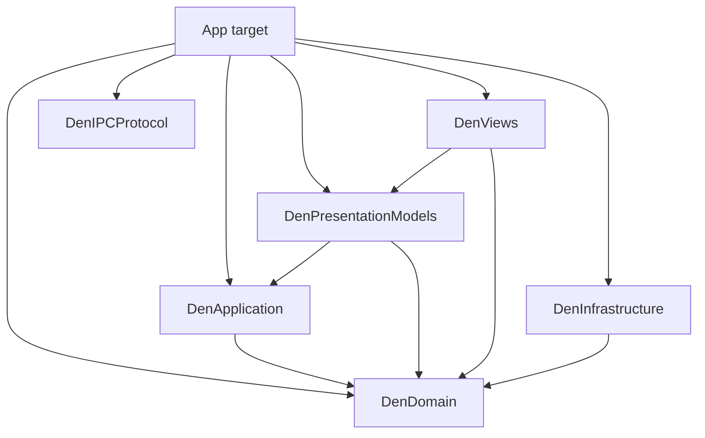

# Architecture

Shared responsibilities are separated into Swift packages. The app target assembles them and
contains Views, native adapters, and operations grouped by product Feature.

## Platform baseline

The app and test targets support macOS 26.0 and later. Availability and runtime capability rules are defined in [the agent guide](../AGENTS.md#platform-baseline).

## Packages and folders

Arrows point from the importing module to its dependency. Only local packages are shown.

| Package | Role |
| --- | --- |
| `DenDomain` | Domain values and product rules |
| `DenApplication` | Shared state source, operation decisions, and state transformations |
| `DenPresentationModels` | Observable presentation Models and window-local state/effects |
| `DenViews` | Feature Views, native display adapters, and shared visual tokens and controls |
| `DenInfrastructure` | Profile persistence and performance diagnostics |
| `DenIPCProtocol` | CLI/app request and response types |

App-target folders:

| Folder | Role |
| --- | --- |
| `App` | App entry, settings assembly, keyboard integration, and dependency composition |
| `Features` | Feature-owned Views, operation adapters, and native implementations |
| `IPC` | Socket transport and request handling |
| `Platform` | Feature-independent OS integration |
| `PrivateWebKit` | Private WebKit API declarations |
| `Resources` | Bundled assets |

Within Features, Application coordinates operations, Presentation renders UI, and
Infrastructure integrates native SDKs. Folders describe ownership; package dependencies
enforce shared layer boundaries. Den coordinates operations spanning
Desks, Boards, and Drawer. Board kind-specific code belongs to Board; shared Web integration
belongs to Web.

## Shared state and presentation package boundaries

`DenApplication` depends only on Foundation, Observation, and `DenDomain`. One `DenStateStore` per Profile
owns a `DenSharedState` value: Den data, Desk Presets, Recent Items, Notifications, active drag,
and removal histories. `DenState` and other persisted value types remain in `DenDomain`.
The Store is `@Observable` and exposes a read-only snapshot. Views observe the authoritative
value through live getters. Its separate `DenStateWriter` is created together with the Store and retained privately by the app's
`DenProfileResources` adapter. Readers cannot obtain a writer for an existing Store.

`DenPresentationModels` owns display values for pending confirmations, including
`DenConfirmationRequest` and `PendingDeskReplacement`.
The App-target Controller adapter executes confirmed operations. The Application core has no
Presentation dependency. Board operation origin and zmx operation outcomes are Domain values.

`DenApplication` contains Board input interpretation, opening decisions, and pure Board/Desk
state transformations. These functions return values and typed outcomes without owning window
state or native resources. `DenController` coordinates their execution, applies results to the
shared state source, and connects Runtime operations, persistence, and window effects.
`BoardOpening.resolve` returns a Board creation decision with its optional Recent item,
a Tutorial request, a session-picker request, or a validation failure. It does not call insertion,
Recent, or Tutorial actions. Controller currently executes that decision in order.
`DrawerPlacement` owns its create-before-discard sequence; App supplies the concrete operations. Application has no dependency on Presentation.

Personal Desk Preset management uses `DeskPresetOperations` in DenApplication for validation,
shared-state updates, and persistence. App supplies the persistence function; Controller translates
outcomes into confirmation and feedback. The management and save panels receive Preset values and
narrow actions from App composition, without a Controller reference. Presets remain in the Profile's
existing state source; the native resource adapter exposes their collection read-only.

`BoardMovement` owns group reordering, Desk-to-Desk transfer, and order restoration against the
same Profile state source. Normal actions, Overview, and drag handling share this entry point.
Controller retains window focus, scrolling, PiP, drag lifecycle, and persistence timing.

Preference value types follow their meaning: `SearchEngine` and `ExternalLinkDestination` belong
to Domain, while `DrawerStyle` belongs to DenPresentationModels. `AppPreferences` owns their
persisted selections.

`DenInfrastructure` contains `ProfilePersistence`, its schema DTOs and migration decoder,
and `PerformanceTrace`. It depends only on DenDomain, Foundation, and OS diagnostics.
App adapters retain Profile lifecycle and native resources.

`DenPresentationModels` depends on Foundation, Observation, `DenDomain`, and `DenApplication`.
It contains Models and state/effect values, with no Views or shared visual components.
Shared components and the Notification View belong to DenViews; other Feature Views still reside in App. Controller imports use the presentation value contracts.
Existing Models receive live data getters and only the operations they use. Models may also receive concrete
Application operations through public construction initializers, retaining the Store and operations privately.
Such initializers use `public import DenApplication`; View-facing properties and methods expose Domain
or display values, never an operation or writer. Models cannot import the app target, DenController,
or native runtimes. The app's `App/Composition/DenWindowComposition` supplies
the data and operations; [Window presentation model](#window-presentation-model) describes its lifecycle and effect connection.

UDF uses two paths: shared-data changes invalidate reads; window effects request presentation changes.
Unmigrated Views read through the read-only DenController facade; NotificationListView reads its Model.
Views request operations instead of writing shared values.
Getters forward to the observable source without copying authoritative data.
Native runtimes and persistence callbacks stay in the app adapter and do not enter `DenSharedState` or its serialization.

State ownership:

| State | Source and scope | Persistence |
| --- | --- | --- |
| Desk/Board identity, order, saved state, Drawer Items, Presets, Recents | One `DenStateStore` per Profile | Profile document |
| Notifications, active drag, removal/restoration histories | The same Profile state source | Transient |
| Panels, modes, queries, selections, expansion, drafts | Window and Feature presentation Models | Window lifetime |
| Live Sheet Stack, WebKit and Terminal execution | Concrete runtimes retained by Profile resources | Runtime objects are never serialized |
| Profile metadata and app preferences | Existing `ProfileManager` and `AppPreferences` owners | Profile/preferences storage |

`DenState.focusedDeskID` retains the shared restore selection; each window's `presentedDeskID`
remains separate. Desk-level Board focus is shared, while filter and Overview selections are local.
For an active Web runtime, its Sheet Stack is authoritative and saved Board URL/title fields are
updated projections; those saved fields supply initial state when restoring a runtime.

`App/Composition/DenProfileResources` connects the shared state source, persistence callbacks,
window event owners, and the native registry. `DenBoardRuntimes` owns Profile-shared Web and
Terminal runtimes and their disposal; `DenWindowResources` owns the Drawer Peek and zmx command Task,
and privately manages the screenshot operation Task. `ScreenshotCapture` returns an image; Controller selects the
target Sheet, requests capture, and passes the image to `ScreenshotOutput` for save or clipboard
output before reporting feedback. Closing the window cancels the operation.
Web Boards and Drawer Peek use the same `WebRuntime` type. Placing
the invoking window’s Peek transfers that instance into the Profile registry and attaches Board
actions and identity without loading, reloading, or disposing its WebView. Board insertion must
succeed before the window releases ownership; other windows’ Peeks of the removed Item are disposed. Closing one window releases its resources while shared Board runtimes
remain alive for other windows. These native resource holders are app-target adapters.

Web Boards and Drawer Peek allow HTTP content, including LAN and Tailscale IP addresses.
The app's Info.plist sets `NSAllowsArbitraryLoadsInWebContent` to exempt `WKWebView`
loads from ATS restrictions while retaining default ATS protections for `URLSession`.

`DenViews` directly depends on `DenPresentationModels` and Domain. There is one Model / VM target,
which remains independent of display SDKs. App composition passes an existing `NSView` directly
to the View adapter; attaching, displaying, and detaching native views belongs to the View boundary.
The Profile registry retains Runtime creation and disposal. WebKit private declarations, Ghostty
integration, and embedded JavaScript remain in the app target. IPC calls the common native
implementations without constructing a screen Model. This boundary follows
[ADR 0066](./adr/0066-separate-views-from-native-runtime-ownership.md).

`M0BoundaryProbe` in App composition retains the native display construction probe.
The real Notification Model/View replaced the initial Board order probes; API validation now
checks NotificationListModel. `NativeSurfaceView` verifies the display connection.
The product's `DenController` workflows, native integration, and Feature Views still remain in the app target.
Their folder boundaries are not compiler-enforced. Layer import guards
reject Presentation access to the mutable adapter. This boundary follows
[ADR 0062](./adr/0062-profile-state-source-and-presentation-models.md).

## Dependency direction

- `App` assembles scenes, windows, commands, and dependencies. It does not acquire feature behavior merely because multiple Features use it.
- `DenViews/Shared` provides shared visual presentation. Motion preference storage remains in AppPreferences; its choice value belongs to DenPresentationModels so Models never depend on Views. The consolidation follows [ADR 0067](./adr/0067-consolidate-shared-ui-and-notifications-in-views.md).
- `Domain` contains state and product rules. It does not depend on `DenController`, Application-owned operation events, SwiftUI, AppKit, WebKit, or live runtime objects. Domain groups may reference one another according to the product model: Den contains Desks, and Desks contain Boards.
- `DenDomain` is the compiler-enforced module for the moved shared Domain values. It depends only on Foundation and keeps the app's Swift 6 MainActor isolation policy.
- `Application` owns operation sequencing, application state, and runtime lifecycle coordination. `DenController` remains the app-target operation entry point.
- `Presentation` owns views, window-local UI models, geometry, visual tokens, and display mappings as independent functions. Existing views may use `DenController` across source groups; Feature presentation models should receive the narrowest practical live state and operations through Den composition. Use live getters when copied values would lose Observation updates; do not mirror `DenController` with per-Feature stores or broad protocols. Native view adapters may use their concrete runtimes.
- `Infrastructure` owns concrete WebKit, Terminal, persistence, and process integration. Application code can call these implementations directly; folder organization alone does not justify a protocol, repository, or coordinator.
- `Platform` contains only feature-independent operating-system integration. Product URL rules and Den lifecycle remain with their owners.
- IPC is an application adapter shared with the bundled CLI. `DenIPCProtocol` supplies the typed operation envelope and response DTOs; socket transport does not own Board or Profile policy.
- Feature-specific settings UI remains with its owner. `App/Settings` assembles those screens.

Folders describe ownership within the app target; Swift packages enforce module boundaries.
Judge app-target dependencies by responsibility rather than treating each Feature as a module.
Keep domain rules free of UI and runtime dependencies, and use narrow entry points for cross-domain operations.

WebExtension integration uses the existing `WebExtensionHost` boundary. Board and Drawer supply their WebKit instances and URL-loading callbacks; Extensions owns tab registration and never imports Den runtime types. Profile-window keyboard ownership follows [keyboard-input.md](./keyboard-input.md).

## Den state and live runtimes

The [state ownership table](#shared-state-and-presentation-package-boundaries) defines shared, window-local, and persisted state. Live runtime objects remain outside persisted Profile data.

- `WebRuntime` owns live WebKit state, including each Web Board's in-memory Sheet Stack. Web Boards have a Sheet Stack, while Terminal Boards present one Sheet backed by a live Terminal Session.
- `BoardState.kind` distinguishes Web, Inspection, Terminal, and Tutorial Boards and carries their kind-specific state. Tutorial Boards and their progress are session-only and stay out of persisted DenState and Desk Presets. Terminal session choices (Shell, Zellij, and zmx) belong to Terminal Board state; URLs and Vim-style Sheet Navigation settings belong to Web Board state.
- `TerminalRuntime` owns one libghostty surface and Shell, Zellij, or zmx process. One controller is used per Terminal Board.
- `DenController` uses shared weak references in `DenProfileResources` to route Board and Desk removal invalidations to every window, so local selections and insertion anchors cannot retain removed IDs. Each Profile window has a `DenController` for its presented Desk and application resources.
- `ProfileManager` retains the event-owner `DenController` for each active Board runtime. Runtime disposal or final Profile-window teardown releases these owners. Closing one window preserves detached runtime event delivery while other Profile windows remain.
- `DenView` renders only the Desk assigned to its window. Shared runtime storage retains both runtime types across Desk and window changes; detached Terminal views stop rendering without ending their process. A detached TerminalRuntime also runs low-frequency app ticks until its surface is visible again or the runtime is disposed; this follows [ADR 0040](./adr/0040-tick-detached-terminal-runtimes.md).
- Drawer Peek runtime and download operations remain in `DenController`. Window-to-Desk assignment is managed by `ProfileManager` and is not persisted.
- zmx session discovery is window-local. Each `DenWindowModel` owns one `ZmxSessionsModel` from `DenPresentationModels`, which owns session listing, filtering, selection, deletion, and their asynchronous Tasks. App composition injects listing and termination operations backed by the current zmx client; each operation batch captures its dependencies through completion. The Model is stopped when the zmx Sessions context closes, so late command results cannot update a closed panel. `DenController` finds existing zmx Boards, updates root metadata, and opens or focuses Boards; the Window Model coordinates the panel transition.
- Persistence never serializes WebKit objects, terminal processes, terminal screens, or scrollback; [persistence.md](./persistence.md) defines the saved data and recovery contract.

This boundary follows [ADR 0008](./adr/0008-codable-den-state-webview-runtime.md).

Terminal embedding and its security boundary follow [ADR 0032](./adr/0032-embed-terminal-boards-with-libghostty.md).

## Window presentation model

The Store and window presentation boundary follows [ADR 0057](./adr/0057-separate-window-presentation-from-den-store.md).

Each mounted Den window retains one `DenWindowComposition` in `App/Composition`. It constructs the
Feature Models and one `DenWindowModel`, supplies their dependencies, and connects Controller effects
for the mounted window lifetime. Views, menu commands, and keyboard routing use the same
`DenWindowModel` instance. The Model receives live getters and operation closures; it does not copy
shared Desk or Board state. Views may read observable application state directly without a separate
Model for every View.

Window presentation owns modes, context transitions, layout, confirmations, and input requests.
Context Models own local queries, selections, drafts, and cancellable work; they do not reference one another or copy domain state.
Panels own their `FocusState` and local drafts. Drafts that survive panel replacement belong to a Model;
for example, Open Board retains its draft when returning from Zmx Sessions.
Composition supplies Models and narrow operations; Models pass explicit values or identifiers to those operations.
Confirmation display belongs to Presentation, while the Controller executes confirmed operations.

Controller effects are plain values delivered through one synchronous callback, preserving all effects
and their order and updating input context before the next keyboard event.
The callback is connected only for the mounted window lifetime, not during construction;
disconnecting cancels presentation work. The App-target Controller emits Presentation-owned values
without referencing the Model; the Application core remains independent of Presentation.
CLI and IPC call Controller operations directly.

Animation requests precede the Board mutations they affect; Views apply SwiftUI transactions.
Presentation Models and Application do not construct them. Tutorial progress and step ordering belong to Application and Domain.

Feedback is plain operation data. Presentation owns Toast display and timing; Views own styling and animation.
Toast activation sends an explicit target to an injected application operation.

## Feature boundaries

### Den

Den coordinates operations spanning Desks, Boards, and Drawer. `DenController` connects these
operations to native resources and persistence. `DenWindowModel` coordinates window presentation;
App composition supplies live data and focused operations to it and the Feature Models.

Desk owns Desk state and preset data. Board owns shared Board state and grouping plus its Web, Terminal, Inspection, and Tutorial implementations. Drawer owns Drawer Items, its view, and Peek runtime; Drawer-to-Board placement remains a Den Application workflow. Feature inputs follow [ADR 0061](./adr/0061-narrow-feature-presentation-inputs.md) and the package boundaries above. Terminal owns launch command selection and zmx query results used to prepare duplication; DenController owns task cancellation, focus checks, Board naming against current Den state, and insertion.

Den also owns preferences for shared presentation behavior. `IPC/Application` connects external CLI and MCP requests to active Profile windows through existing domain operations, following [ADR 0047](./adr/0047-integrate-den-cli.md) and [ADR 0055](./adr/0055-add-den-mcp-server.md).

### Overview

Overview owns its View and observable Model. Its app-target Infrastructure owns
`BoardFacingCapture` for native snapshots and `BoardFacingCache` for
transient images, memory budgeting, and capture invalidation.
`BoardFacingDiskCache` serializes image encoding, decoding, and filesystem
operations on an actor outside the main actor, retaining disposable snapshots for
ordinary Profiles. Private Den supplies no disk cache. Profile resources
retain these native adapters; they are not part of persisted Den state. Den coordinates its window transitions and the application operations that focus or rearrange Desks and Boards.

### BoardActivity

BoardActivity owns the resource-usage screen in Presentation and process sampling in Infrastructure. The screen reads shared Board state and runtimes through DenController; Den coordinates opening, closing, and entering a Board from the screen.

### Essentials and Notifications

Essentials owns the `Essential` model, the Prefix panel, and Essential settings. The collection remains app-wide in `AppPreferences`; the Settings scene assembles its feature-owned screen. Den coordinates Prefix presentation and opening an Essential as a Board.

Notifications owns the `DenNotification` value, list UI, and list-local selection. One
`NotificationOperations` per Profile privately retains the Store's writer and performs recording,
read-state updates, source resolution for opening, and clearing. NotificationListModel receives
that concrete operation and the existing Store; it maps current Desk/Board labels directly without
retaining a copy of the shared collection. Its View lives in DenViews and imports only the Model
and Domain product modules.

Composition injects a source-opening callback for the invoking window's existing Board navigation.
Opening marks the message read before that synchronous call; a missing source reports a warning
in that window. Clear confirmation stays in presentation: the list Model emits the count through
`onRequestClearConfirmation`, and composition delivers it directly to DenWindowModel using a weak
reference. Confirmation display does not return through Controller. Runtime notification entry points delegate to the same shared operation, then emit the
existing notification-added effect and feedback in order. Confirmed clearing also uses the shared
operation and clears the invoking window's notification feedback. The operation retains no window
or Model. Composition keeps its existing weak window-effect connection, and Runtime owners keep
their existing lifetime.

### Profiles

Owns Profile identity, Profile-scoped persistence, website-data isolation, and Profile window lifecycle. A Profile owns one Den and may present distinct Desks from it in multiple windows, so this Feature may depend on the Den Feature to create, restore, and present that Den. WebKit storage mechanics may live in `Platform`, while Profile policy remains in the feature.

`ProfileManager` owns the lifecycle binding: one lazily created `MV3WebExtensionHost` per Profile and one extension window per Profile Window using that host. When content blocking is enabled, the first live Web Board, Drawer Peek, or explicit extension popup/options request creates the host. Creating or focusing an empty or Terminal-only Profile Window does not load the extension. Ordinary Profiles use a persistent extension controller identified by their stable Profile ID; Private Den uses a non-persistent extension controller so its extension state does not carry into another session.

### Extensions

Owns curated WebExtension descriptors, permissions, on-demand installation, resource loading, and the per-Profile MV3 WebKit host. It does not own Profile identity or website-data policy; `Profiles` supplies lifecycle and `WKWebsiteDataStore` bindings. It does not own Den concepts; `Den` supplies Board and Drawer runtime registration at the narrow host boundary. Arbitrary extension installation remains outside this boundary.

### SheetNavigation

Owns optional Vim-style interaction within the Current Sheet: preferences, validation, settings UI, WebKit content-controller integration, and the bundled script. It does not own Board lifecycle or persisted Sheet state. Den injects the shared controller into each Board runtime and handles requests to open a link as another Board.

### Settings

Settings > Web provides app-wide Search Engine and automatic Picture in Picture choices. The search choice persists across relaunches and applies when search terms are opened, including saved Recent Items and Essentials. Automatic Picture in Picture moves a playing video from the Focused Board into native Picture in Picture when the user switches Desks; it is disabled by default. Explicit URLs and existing Sheets remain unchanged.

Settings is not a Feature. `App/Settings` owns the Settings scene and its navigation. Feature-owned settings state and UI stay with the Feature that controls the behavior: Profile management belongs to `Features/Profiles`, Sheet Navigation settings belong to `Features/SheetNavigation`, and appearance, shortcuts, and Board layout preferences belong to `Features/Den`. The Settings scene assembles those screens without taking ownership of their behavior.

### Platform

Contains reusable operating-system integration rather than product concepts. Do not create a global Platform folder merely because code imports AppKit or WebKit. `TextInputComposition` is a feature-independent IME composition helper shared by Den, Sheet Navigation, and App settings. `SurfaceHost` is a generic native-view host shared by Board kind adapters and Drawer Peek; its API uses only AppKit views and generic request values. `WebRuntime` belongs to `Web` because Web Boards and Drawer Peek share its live execution; `WebBoardSurface` remains in `Board/Web` because it owns Board presentation. `SheetNavigationManager` remains in SheetNavigation because its WebKit integration implements that Feature. `KeyboardController` remains in `App` while it routes app-wide commands into Den behavior. A component moves to `Platform` only when its API is feature-independent and no reverse dependency on a Feature is required.

## Folder rules

- Prefer feature-local files over global `Models`, `Managers`, `Utilities`, or `Views` folders.
- Use Domain, Application, Presentation, and Infrastructure within a source group only where they clarify existing responsibilities. Keep small groups flat rather than creating empty or single-file layer scaffolding.
- Promote code to `Platform` only after a feature-independent boundary genuinely exists; multiple callers alone are not sufficient.
- Keep source moves separate from behavior changes and dependency refactors.
- Keep Domain in one shared model target; split by Feature only when an independent dependency boundary exists.
- Do not edit `project.pbxproj` for ordinary moves under the file-system-synchronized root group.
- Preserve Objective-C bridging-header paths, private WebKit header references, target membership, and bundled resources during moves.

## Validation

Validation boundaries follow [testing.md](./testing.md). Swift source moves require `just check`; resource moves must additionally verify that the bundled Sheet Navigation script loads at runtime. Changes to Feature ownership or dependency direction must update a relevant ADR or add one.

Architecture decisions live in [docs/adr](./adr). Product terminology remains defined only in [CONTEXT.md](../CONTEXT.md).
