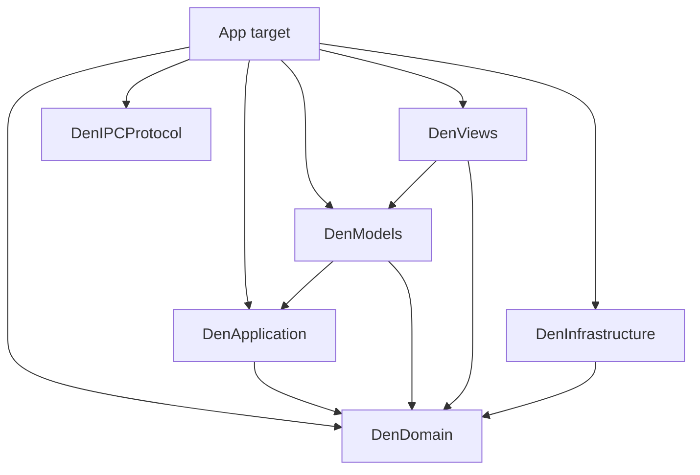

# Architecture

Shared responsibilities are separated into Swift packages. The app target assembles them and
contains scene and dependency composition, with native adapters and operations grouped by product Feature.

## Platform baseline

The app and test targets support macOS 26.0 and later. Availability and runtime capability rules are defined in [the agent guide](../AGENTS.md#platform-baseline).

## Packages and folders

Arrows point from the importing module to its dependency. Only local packages are shown.

| Package | Role |
| --- | --- |
| `DenDomain` | Domain values and product rules |
| `DenApplication` | Shared state source, operation decisions, and state transformations |
| `DenModels` | Observable presentation Models and window-local state/effects |
| `DenViews` | Feature Views, native display adapters, and shared visual tokens and controls |
| `DenInfrastructure` | Profile persistence and performance diagnostics |
| `DenIPCProtocol` | CLI/app request and response types |

App-target folders:

| Folder | Role |
| --- | --- |
| `App` | App entry, settings assembly, keyboard integration, and dependency composition |
| `Features` | Feature-owned operation adapters and native implementations |
| `IPC` | Socket transport and request handling |
| `Platform` | Feature-independent OS integration |
| `PrivateWebKit` | Private WebKit API declarations |
| `Resources` | Bundled assets |

Within app Features, Application coordinates native operations and Infrastructure integrates
native SDKs. DenViews owns rendering, and DenModels owns observable screen state. Folders describe ownership; package dependencies
enforce shared layer boundaries. Den coordinates operations spanning
Desks, Boards, and Drawer. Board kind-specific code belongs to Board; shared Web integration
belongs to Web.

## Shared state and presentation package boundaries

`DenApplication` depends only on Foundation, Observation, and `DenDomain`. One `DenStateStore` per Profile
owns a `DenSharedState` value: Den data, Desk Presets, Recent Items, Notifications, active drag,
and removal histories. `DenState` and other persisted value types remain in `DenDomain`.
The Store is `@Observable` and exposes a read-only snapshot. Views observe the authoritative
value through live getters. Its separate `DenStateWriter` is created together with the Store and retained privately by the app's
`DenProfileResources` adapter. Readers cannot obtain a writer for an existing Store.

`DenModels` owns display values for pending confirmations, including
`DenConfirmationRequest` and `PendingDeskReplacement`.
App composition routes confirmed operations to their shared operations and focused native adapters. The Application core has no
Presentation dependency. Board operation origin and zmx operation outcomes are Domain values.

`DenApplication` contains Board input interpretation, opening decisions, pure Board/Desk state
transformations, and shared stateful operations. `BoardOpening.resolve` returns a Board creation
decision with its optional Recent item, a Tutorial request, a session-picker request, or a validation
failure. It does not invoke insertion, Recent, or Tutorial actions.

One `BoardCreation` per Profile executes these decisions against the existing Store and private
writer. It validates insertion, requests synchronous preparation, updates the Desk, requests window
focus, saves, synchronizes Native metadata/Tutorial events, and records Recent in the established
order. An insertion with Recent defers its save until Recent has been updated. Failed saves retain
the created Board and restore the previous Recent collection; App keeps the existing persistence
retry and recovery behavior. `BoardCreation` delegates recording to the Profile's concrete `Recents`
operation. The same operation handles removal, clearing and first-page-title completion against the
existing Store; App's Recent collection accessor is read-only. Title reuse, deduplication and the
500-item limit remain unchanged. Each failed persistence attempt restores only the prior Recent
collection, including titles and order. Profile persistence takes precedence over the standalone
Recent callback; its drag guard and the existing Recent-only fallback policy remain unchanged.

Every call supplies a `BoardCreation.Target` and a synchronous `Notice` callback. The target contains
the invoking window's presented Desk, optional destination Desk/anchor, focus and operation origin.
The operation retains no window, callback, Runtime or Model. Notices describe only Board creation
stages; App translates them into Native attachment and the invoking window's existing effects.
Animation and link-focus preparation finish before the Store mutation. Runtime attachment precedes
that preparation; post-insertion Runtime metadata and Tutorial events precede Recent recording.

OpenBoardModel directly receives the concrete creation operation; Composition supplies current
request values and notification delivery. Search, Essentials, Clipboard, Recent and native creation
adapters delegate to the same operation. IPC Web/Terminal creation calls it directly, preserving
transport validation, target resolution and response conversion without a screen Model.
Popup, Side Board, duplication and Drawer placement also share its insertion path. App retains
Native Runtime ownership, async zmx cancellation and window presentation. Application has no
Presentation dependency.

`DrawerItems` records, discards, restores and updates Drawer Items and their bounded transient
history through the same Profile writer. It validates supported URLs before preparing a Peek change,
repairs window presentation after removal but before saving, and saves metadata only when changed.
`DrawerPlacement` calls the concrete BoardCreation operation, then consumes the source Item without
adding discard history or advancing the Peek. A failed creation leaves the Item and Peek untouched.
UI/Keyboard adapters and IPC share these operations; each call supplies its target and synchronous
notification destinations. Neither operation retains a window, Model or Runtime.

App keeps the invoking window's Peek until BoardCreation accepts insertion. Its existing attachment
adapter then transfers that exact WebRuntime into the Profile's Board runtime map; Item removal
subsequently releases other windows' Peeks and repairs their selections. This preserves Runtime
identity and download/navigation callbacks after success; failed placement leaves every Peek
untouched. DenWindowResources owns the window Peek, and DenProfileResources owns the weak
presentation registry and shared Board runtime map.

`InputOpening` handles Essentials, Clipboard and external-URL opening through the same BoardCreation
and DrawerItems operations. App supplies explicit width, target and opening configuration; Clipboard
reading, native notice delivery and feedback rendering remain App bindings. `EssentialEditing` reads
and writes the existing AppPreferences collection through concrete bindings, normalizes quick-save
input, returns replacement confirmation values, and revalidates identity/key after confirmation.
It creates no preference copy or feature Store. `BoardUpdates` owns explicit Board rename/navigation
and zmx-root metadata writes and their existing notification/save ordering.

`TutorialProgress` records the first Tutorial's ordered steps in the Profile Store; operation events
are forwarded only after that update. Tutorial state remains session-only. `DeskLinkExport` performs
pure Markdown escaping/formatting in Application; App's existing save panel and NSPasteboard remain
the output adapters. `ScreenshotOutput` now executes capture/output cancellation checks with the
existing ScreenshotCapture implementation, while DenWindowResources retains the cancellable task.

`ZmxBoards` is an App native-client workflow using the existing ZmxClient, BoardCreation, BoardRemoval
and BoardUpdates. It re-reads shared state and weak window context after async inspection, keeps
source-focus/side-Board validity and active-name collision checks, and ignores cancelled or closed-window
results. Window task ownership remains in DenWindowResources; the operation retains no window assembly.

`FeedbackModel` holds latest feedback per window; DenWindowModel retains displayed-feedback expiry
and tap presentation. App forwards effects and native target navigation.

`BoardRemoval` owns Board removal and restoration against the same Profile Store.
Its planRemoval method and BoardRestoration provide the pure calculations, records bounded removal history,
consumes history only after successful restoration, and preserves save-failure state. Each call
supplies the presented Desk and a synchronous notification destination. App handles Native disposal,
input-source cleanup, Overview/reference invalidation, Desk presentation and feedback. Background
CLI animation/removal preparation precedes Store mutation; cleanup and reference invalidation finish
before persistence. Overview composition and IPC close use the operation directly; remaining
App callers use BoardRemovalPresentation for native cleanup and window effects. Runtime ownership and disposal implementation remain in App.

`DeskLifecycle` reuses DeskCreation/DeskDeletion/DeskReplacement for creation, duplication,
confirmed replacement and deletion. App supplies the calling window's
presented Desk, insertion anchor, availability predicate and synchronous notification destination.
Replacement/deletion preparation disposes native resources before the Store changes; reference
invalidation finishes before saving. Confirmations remain window presentation state, and the
confirmed operation revalidates its Desk target. Native Facing copies stay in App after duplication.

Window assignment, PiP and input-source changes stay in the existing App presentation adapter.
`DeskUpdates` records names, scroll offsets and the existing shared focusedDeskID.
Only after App accepts a Desk switch does it ask DeskUpdates to record that selection;
the operation never owns a window's presentedDeskID. `DeskMovement` owns Desk reordering and drag
state; previews/order restoration do not persist, while drag completion clears drag before saving.

`DenReset` preserves the existing sequence: prepare Profile/window/native cleanup, cancel drag,
replace Den data, synchronize the invoking window's Desk/preferences, clear input and transient
histories/notifications, clear window references, save, then finish presentation and feedback.
It uses the same Store and retains Recents and personal Presets, as before. App keeps its existing
Profile-window cleanup and native ownership callbacks. None of these operations retains a window,
Model, Runtime, availability predicate or notification destination.

Personal Desk Preset management uses `DeskPresetOperations` in DenApplication for validation,
shared-state updates, and persistence. App supplies the persistence function; DeskPresetActionsAdapter translates
outcomes into confirmation and feedback. The management and save panels receive Preset values and
narrow actions from App composition, without a Controller reference. Presets remain in the Profile's
existing state source; the native resource adapter exposes their collection read-only.

`BoardMovement` owns group reordering, Desk-to-Desk transfer, Board drag state and order restoration
against the same Profile state source. Normal actions, Overview, drag handling and IPC share it.
Committed moves save only when no drag is active; preview and order restoration do not save.
Overview drops clear drag before saving and preserve the destination focus. Window moves request
centering or Desk presentation synchronously before saving; App handles PiP and window effects.

`BoardSizing` owns manual and paired resize, Desk-wide adjustment and fit-width updates against
that source. Manual previews do not save until committed; adjustments request deferred persistence
only when widths change, with the existing immediate-save route when no deferrer is installed.
Window Model holds the concrete sizing operation privately; its sizing actions no longer return
through a native adapter. It retains layout metrics, maximization, panel state and centering requests.

`BoardDuplication.resolve` returns a new Board value or a request for Native zmx session preparation.
The App adapter inserts ordinary copies through BoardCreation. zmx queries, cancellation and client
execution retain their existing App lifetime and use the same creation operation after preparation.

Preference value types follow their meaning: `SearchEngine` and `ExternalLinkDestination` belong
to Domain, while `DrawerStyle` belongs to DenModels. `AppPreferences` owns their
persisted selections.

`DenInfrastructure` contains `ProfilePersistence`, its schema DTOs and migration decoder,
and `PerformanceTrace`. It depends only on DenDomain, Foundation, and OS diagnostics.
App adapters retain Profile lifecycle and native resources.

`DenModels` depends on Foundation, Observation, `DenDomain`, and `DenApplication`.
It contains Models and state/effect values, with no Views or shared visual components.
DenViews contains shared components, feature panels, Tutorial, Drawer lists, headers, and settings contents.
App observes native Runtime/Facing state and assembles their existing NSViews, values and callbacks; rendering belongs to DenViews.
Existing Models receive live data getters and only the operations they use. Models may also receive concrete
Application operations through public construction initializers, retaining the Store and operations privately.
Such initializers use `public import DenApplication`; View-facing properties and methods expose Domain
or display values, never an operation or writer. Models cannot import the app target
or native runtimes. The app's `App/Composition/DenWindowComposition` supplies
the data and operations; [Window presentation model](#window-presentation-model) describes its lifecycle and effect connection.

UDF uses two paths: shared-data changes invalidate reads; window effects request presentation changes.
Feature Views read their Models; native adapters read the Profile Store and explicit window inputs.
Views request operations instead of writing shared values.
Getters forward to the observable source without copying authoritative data. BoardEditingModel and DeskListModel
retain concrete shared operations privately and are created once per DenWindowModel. The View tree, Commands,
and Keyboard use that window instance. Settings Models read the existing AppPreferences or ProfileManager
owner on each access; drafts remain local to their Views. Shortcut values live in the Model module,
while AppKit key conversion and recording belong to Views.
Native runtimes and persistence callbacks stay in the app adapter and do not enter `DenSharedState` or its serialization.

State ownership:

| State | Source and scope | Persistence |
| --- | --- | --- |
| Desk/Board identity, order, saved state, Drawer Items, Presets, Recents | One `DenStateStore` per Profile | Profile document |
| Notifications, active drag, removal/restoration histories | The same Profile state source | Transient |
| Panels, modes, queries, selections, expansion, drafts | Window and Feature presentation Models | Window lifetime |
| Live Sheet Stack, WebKit and Terminal execution | Concrete runtimes retained by Profile resources | Runtime objects are never serialized |
| Profile metadata and app preferences | Existing `ProfileManager` and `AppPreferences` owners | Profile/preferences storage |

`DenState.focusedDeskID` retains the shared restore selection; each window's `presentedDeskID`
remains separate. `WindowNavigationModel` owns this selection and the window's previous Desk and
Anchor return references. Window and Desk Models use the same navigation instance from composition. It projects the shared Store's current Desk and Board values without retaining snapshots.
Desk-level Board focus is shared, while filter and Overview selections are local.
For an active Web runtime, its Sheet Stack is authoritative and saved Board URL/title fields are
updated projections; those saved fields supply initial state when restoring a runtime.

`App/Composition/DenProfileResources` connects the shared state source, persistence callbacks,
window connections, and the native registry. `DenBoardRuntimes` owns Profile-shared Web and
Terminal runtimes and their `BoardRuntimeReceiver`s. Receivers hold Profile resources weakly and update
shared Application operations directly. Native callbacks retain only a window connection with weak
references to focused native adapters, explicitly disconnected on window close. Runtime disposal clears its callbacks and
releases the receiver; an external Runtime reference does not retain a closed window or Profile resources.
`DenWindowResources` owns the Drawer Peek and zmx command Task,
and privately manages the screenshot operation Task. `ScreenshotCapture` returns an image; BoardScreenshots selects the
target Sheet, requests capture, and passes the image to `ScreenshotOutput` for save or clipboard
output before reporting feedback. Closing the window cancels the operation.
Web Boards and Drawer Peek use the same `WebRuntime` type. Placing
the invoking window’s Peek transfers that instance into the Profile registry and attaches Board
actions and identity without loading, reloading, or disposing its WebView. Board insertion must
succeed before the window releases ownership; other windows’ Peeks of the removed Item are disposed. Closing one window releases its resources while shared Board runtimes
remain alive for other windows. These native resource holders are app-target adapters.

Web Boards and Drawer Peek allow HTTP content, including LAN and Tailscale IP addresses.
The app's Info.plist sets `NSAllowsArbitraryLoadsInWebContent` to exempt `WKWebView`
loads from ATS restrictions while retaining default ATS protections for `URLSession`.

`DenViews` directly depends on `DenModels` and Domain. There is one Model / VM target,
which remains independent of display SDKs. App composition passes an existing `NSView` directly
to the View adapter; attaching, displaying, and detaching native views belongs to the View boundary.
The Profile registry retains Runtime creation and disposal. WebKit private declarations, Ghostty
integration, and embedded JavaScript remain in the app target. IPC calls the common native
implementations without constructing a screen Model. This boundary follows
[ADR 0066](./adr/0066-separate-views-from-native-runtime-ownership.md).

`NativeDisplayIntegrationTests` mounts existing WebKit and Terminal views through the production
`NativeSurfaceView`, verifying remount identity and bundled JavaScript. There is no separate probe adapter.
Native integration, Runtime/Facing assembly, and focused operation adapters remain in the app target.
Their folder boundaries are not compiler-enforced. Import guards enforce package dependencies;
the Model API guard rejects public operation/write-capability exposure outside construction initializers.
This boundary follows
[ADR 0062](./adr/0062-profile-state-source-and-presentation-models.md).

## Dependency direction

- `App` assembles scenes, windows, commands, and dependencies. It does not acquire feature behavior merely because multiple Features use it.
- `DenViews/Shared` provides shared visual presentation. Motion preference storage remains in AppPreferences; its choice value belongs to DenModels so Models never depend on Views. The consolidation follows [ADR 0067](./adr/0067-consolidate-shared-ui-and-notifications-in-views.md).
- `Domain` contains state and product rules. It does not depend on App adapters, Application-owned operation events, SwiftUI, AppKit, WebKit, or live runtime objects. Domain groups may reference one another according to the product model: Den contains Desks, and Desks contain Boards.
- `DenDomain` is the compiler-enforced module for the moved shared Domain values. It depends only on Foundation and keeps the app's Swift 6 MainActor isolation policy.
- `Application` owns operation sequencing, application state, and runtime lifecycle coordination. App native adapters connect the corresponding operations to native resources.
- `Presentation` owns views, window-local UI models, geometry, visual tokens, and display mappings as independent functions. Feature presentation Models receive live state and focused operations through App composition. Use live getters when copied values would lose Observation updates; do not duplicate shared state in per-Feature stores or broad protocols. Native view adapters may use their concrete runtimes.
- `Infrastructure` owns concrete WebKit, Terminal, persistence, and process integration. Application code can call these implementations directly; folder organization alone does not justify a protocol, repository, or coordinator.
- `Platform` contains only feature-independent operating-system integration. Product URL rules and Den lifecycle remain with their owners.
- IPC is an application adapter shared with the bundled CLI. `DenIPCProtocol` supplies the typed operation envelope and response DTOs; socket transport does not own Board or Profile policy.
- Feature-specific settings UI remains with its owner. `App/Settings` assembles those screens.

Folders describe ownership within the app target; Swift packages enforce module boundaries.
Judge app-target dependencies by responsibility rather than treating each Feature as a module.
Keep domain rules free of UI and runtime dependencies, and use narrow entry points for cross-domain operations.

WebExtension integration uses the existing `WebExtensionHost` boundary. Board and Drawer supply their WebKit instances and URL-loading callbacks; Extensions owns tab registration and never imports Den runtime types. Profile-window keyboard ownership follows [keyboard-input.md](./keyboard-input.md).

## Den state and live runtimes

The [state ownership table](#shared-state-and-presentation-package-boundaries) defines shared, window-local, and persisted state. Live runtime objects remain outside persisted Profile data.

- `WebRuntime` owns live WebKit state, including each Web Board's in-memory Sheet Stack. Web Boards have a Sheet Stack, while Terminal Boards present one Sheet backed by a live Terminal Session.
- `BoardState.kind` distinguishes Web, Inspection, Terminal, and Tutorial Boards and carries their kind-specific state. Tutorial Boards and their progress are session-only and stay out of persisted DenState and Desk Presets. Terminal session choices (Shell, Zellij, and zmx) belong to Terminal Board state; URLs and Vim-style Sheet Navigation settings belong to Web Board state.
- `TerminalRuntime` owns one libghostty surface and Shell, Zellij, or zmx process. One controller is used per Terminal Board.
- `DenProfileResources` keeps weak window connections to route Board and Desk removal invalidations to every window, so local selections and insertion anchors cannot retain removed IDs. Each window has a `ProfileWindowSession` that assembles its Models, native adapters and resource holders; it implements no operations.
- The Profile runtime registry retains one `BoardRuntimeReceiver` per live Board. Runtime disposal or final Profile-window teardown releases these receivers. Closing one window preserves detached runtime event delivery while other Profile windows remain.
- `DenView` renders only the Desk assigned to its window. Shared runtime storage retains both runtime types across Desk and window changes; detached Terminal views stop rendering without ending their process. A detached TerminalRuntime also runs low-frequency app ticks until its surface is visible again or the runtime is disposed; this follows [ADR 0040](./adr/0040-tick-detached-terminal-runtimes.md).
- Drawer Peek runtime and native download operations remain App-owned; window download presentation belongs to `DownloadActivityModel`. Window-to-Desk assignment is managed by `ProfileManager` and is not persisted.
- zmx session discovery is window-local. Each `DenWindowModel` owns one `ZmxSessionsModel` from `DenModels`, which owns session listing, filtering, selection, deletion, and their asynchronous Tasks. App composition injects listing and termination operations backed by the current zmx client; each operation batch captures its dependencies through completion. The Model is stopped when the zmx Sessions context closes, so late command results cannot update a closed panel. `ZmxBoardActions` finds existing zmx Boards, updates root metadata, and opens or focuses Boards; the Window Model coordinates the panel transition.
- Persistence never serializes WebKit objects, terminal processes, terminal screens, or scrollback; [persistence.md](./persistence.md) defines the saved data and recovery contract.

This boundary follows [ADR 0008](./adr/0008-codable-den-state-webview-runtime.md).

Terminal embedding and its security boundary follow [ADR 0032](./adr/0032-embed-terminal-boards-with-libghostty.md).

## Window presentation model

The Store and window presentation boundary follows [ADR 0057](./adr/0057-separate-window-presentation-from-den-store.md).

Each mounted Den window retains one `DenWindowComposition` in `App/Composition`. It constructs the
Feature Models and one `DenWindowModel`, supplies their dependencies from the window session, and connects native effects
for the mounted window lifetime. Views, menu commands, and keyboard routing use the same
`DenWindowModel` instance. The Model receives live getters and operation closures; it does not copy
shared Desk or Board state. Views may read observable application state directly without a separate
Model for every View.

Window presentation owns modes, context transitions, layout, confirmations, and input requests.
Context Models own local queries, selections, drafts, and cancellable work; they do not reference one another or copy domain state.
DenViews owns Drawer and temporary-panel overlay layout, transitions and dismissal controls.
App supplies their concrete panel content and native input-restoration callback.
Panels own their `FocusState` and local drafts. Drafts that survive panel replacement belong to a Model;
for example, Open Board retains its draft when returning from Zmx Sessions.
Composition supplies Models and narrow operations; Models pass explicit values or identifiers to those operations.
Confirmation display belongs to Presentation, while composition dispatches confirmed operations to their focused native adapters and shared operations.

Native window effects are plain values delivered through one synchronous callback, preserving all effects
and their order and updating input context before the next keyboard event.
The callback is connected only for the mounted window lifetime, not during construction;
disconnecting cancels presentation work. App native adapters emit Presentation-owned values
without referencing the Model; the Application core remains independent of Presentation.
CLI and IPC use shared Application operations and App native adapters without going through a screen Model.
IPC target resolution selects a Profile and window ID, then reads the Profile Store and a live
presented-Desk input. `IPCWindowBindings` supplies Board, Desk, and Drawer native callbacks and
synchronous operation notifications; it contains no command implementation or screen Model.
The same Profile operations execute mutations for IPC and UI. App composition supplies the Native
functions, so IPC receives no window-session operation facade. These callbacks retain their native dependencies for the request lifetime.
`DenStateNormalization` in Application prepares restored and persisted values; it does not
mutate live state or change the persistence schema.

Animation requests precede the Board mutations they affect; Views apply SwiftUI transactions.
Presentation Models and Application do not construct them. Tutorial progress and step ordering belong to Application and Domain.

Feedback is plain operation data. Presentation owns Toast display and timing; Views own styling and animation.
Toast activation sends an explicit target to an injected application operation.

## Feature boundaries

### Den

Den coordinates operations spanning Desks, Boards, and Drawer. Focused App adapters connect these
operations to native resources; Profile resources connect persistence. `DenWindowModel` coordinates window presentation;
App composition supplies live data and focused operations to it and the Feature Models.

Desk owns Desk state and preset data. Board owns shared Board state and grouping plus its Web, Terminal, Inspection, and Tutorial implementations. Drawer owns Drawer Items, its view, and Peek runtime; Drawer-to-Board placement remains a Den Application workflow. Feature inputs follow [ADR 0061](./adr/0061-narrow-feature-presentation-inputs.md) and the package boundaries above. Terminal owns launch command selection and zmx query results used to prepare duplication; ZmxBoards and ZmxBoardActions coordinate task cancellation, focus checks, Board naming against current Den state, and insertion.

Den also owns preferences for shared presentation behavior. `IPC/Application` connects external CLI and MCP requests to active Profile windows through existing domain operations, following [ADR 0047](./adr/0047-integrate-den-cli.md) and [ADR 0055](./adr/0055-add-den-mcp-server.md).

### Overview

Overview owns its View and observable Model. Its app-target Infrastructure owns
`BoardFacingCapture` for native snapshots and `BoardFacingCache` for
transient images, memory budgeting, and capture invalidation.
`BoardFacingDiskCache` serializes image encoding, decoding, and filesystem
operations on an actor outside the main actor, retaining disposable snapshots for
ordinary Profiles. Private Den supplies no disk cache. Profile resources
retain these native adapters; they are not part of persisted Den state. Den coordinates its window transitions and the application operations that focus or rearrange Desks and Boards.

### BoardActivity

BoardActivity owns its resource-usage screen in DenViews and process sampling in app Infrastructure. BoardActivitySampling holds the mounted panel’s samples and runs until its View task is cancelled. App composition supplies shared Board state, live Native status and sampled values; Den coordinates opening, closing, and entering a Board from the screen.

### Essentials and Notifications

Essentials owns the `Essential` model, the Prefix panel, and Essential settings. The collection remains app-wide in `AppPreferences`; the Settings scene assembles its feature-owned screen. Den coordinates Prefix presentation and opening an Essential as a Board.

Notifications owns the `DenNotification` value, list UI, and list-local selection. One
`NotificationOperations` per Profile privately retains the Store's writer and performs recording,
read-state updates, source resolution for opening, and clearing. NotificationListModel receives
that concrete operation and the existing Store; it maps current Desk/Board labels directly without
retaining a copy of the shared collection. Its View lives in DenViews and imports only the Model
and Domain product modules.

Composition injects a source-opening callback for the invoking window's existing Board navigation.
Opening marks the message read before that synchronous call; a missing source reports a warning
in that window. Clear confirmation stays in presentation: the list Model emits the count through
`onRequestClearConfirmation`, and composition delivers it directly to DenWindowModel using a weak
reference. Confirmation display connects directly to the window Model. Runtime notification entry points delegate to the same shared operation, then emit the
existing notification-added effect and feedback in order. Confirmed clearing also uses the shared
operation and clears the invoking window's notification feedback. The operation retains no window
or Model. Composition keeps its existing weak window-effect connection, and Runtime owners keep
their existing lifetime.

### Profiles

Owns Profile identity, Profile-scoped persistence, website-data isolation, and Profile window lifecycle. A Profile owns one Den and may present distinct Desks from it in multiple windows, so this Feature may depend on the Den Feature to create, restore, and present that Den. WebKit storage mechanics may live in `Platform`, while Profile policy remains in the feature.

`ProfileManager` owns the lifecycle binding: one lazily created `MV3WebExtensionHost` per Profile and one extension window per Profile Window using that host. When content blocking is enabled, the first live Web Board, Drawer Peek, or explicit extension popup/options request creates the host. Creating or focusing an empty or Terminal-only Profile Window does not load the extension. Ordinary Profiles use a persistent extension controller identified by their stable Profile ID; Private Den uses a non-persistent extension controller so its extension state does not carry into another session.

### Extensions

Owns curated WebExtension descriptors, permissions, on-demand installation, resource loading, and the per-Profile MV3 WebKit host. It does not own Profile identity or website-data policy; `Profiles` supplies lifecycle and `WKWebsiteDataStore` bindings. It does not own Den concepts; `Den` supplies Board and Drawer runtime registration at the narrow host boundary. Arbitrary extension installation remains outside this boundary.

### SheetNavigation

Owns optional Vim-style interaction within the Current Sheet: preferences, validation, settings UI, WebKit content-controller integration, and the bundled script. It does not own Board lifecycle or persisted Sheet state. Den injects the shared controller into each Board runtime and handles requests to open a link as another Board.

### Settings

Settings > Web provides app-wide Search Engine and automatic Picture in Picture choices. The search choice persists across relaunches and applies when search terms are opened, including saved Recent Items and Essentials. Automatic Picture in Picture moves a playing video from the Focused Board into native Picture in Picture when the user switches Desks; it is disabled by default. Explicit URLs and existing Sheets remain unchanged.

Settings is not a Feature. `App/Settings` owns the Settings scene and its navigation. Feature-owned settings state and UI stay with the Feature that controls the behavior: Profile management belongs to `Features/Profiles`, Sheet Navigation settings belong to `Features/SheetNavigation`, and appearance, shortcuts, and Board layout preferences belong to `Features/Den`. The Settings scene assembles those screens without taking ownership of their behavior.

### Platform

Contains reusable operating-system integration rather than product concepts. Do not create a global Platform folder merely because code imports AppKit or WebKit. `TextInputComposition` is a feature-independent IME composition helper shared by Den, Sheet Navigation, and App settings. `SurfaceHost` is a generic native-view host shared by Board kind adapters and Drawer Peek; its API uses only AppKit views and generic request values. `WebRuntime` belongs to `Web` because Web Boards and Drawer Peek share its live execution; `WebBoardSurface` belongs to DenViews because it owns native display attachment for Board presentation. `SheetNavigationManager` remains in SheetNavigation because its WebKit integration implements that Feature. `KeyboardController` remains in `App` while it routes app-wide commands into Den behavior. A component moves to `Platform` only when its API is feature-independent and no reverse dependency on a Feature is required.

## Folder rules

- Prefer feature-local files over global `Models`, `Managers`, `Utilities`, or `Views` folders.
- Use Domain, Application, Presentation, and Infrastructure within a source group only where they clarify existing responsibilities. Keep small groups flat rather than creating empty or single-file layer scaffolding.
- Promote code to `Platform` only after a feature-independent boundary genuinely exists; multiple callers alone are not sufficient.
- Keep source moves separate from behavior changes and dependency refactors.
- Keep Domain in one shared model target; split by Feature only when an independent dependency boundary exists.
- Do not edit `project.pbxproj` for ordinary moves under the file-system-synchronized root group.
- Preserve Objective-C bridging-header paths, private WebKit header references, target membership, and bundled resources during moves.

## Validation

Validation boundaries follow [testing.md](./testing.md). Swift source moves require `just check`; resource moves must additionally verify that the bundled Sheet Navigation script loads at runtime. Changes to Feature ownership or dependency direction must update a relevant ADR or add one.

Architecture decisions live in [docs/adr](./adr). Product terminology remains defined only in [CONTEXT.md](../CONTEXT.md).
